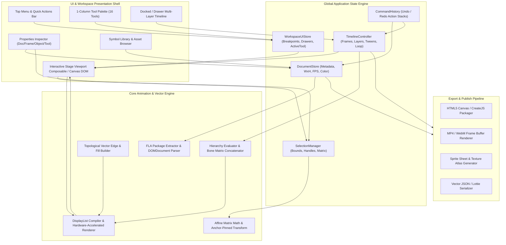
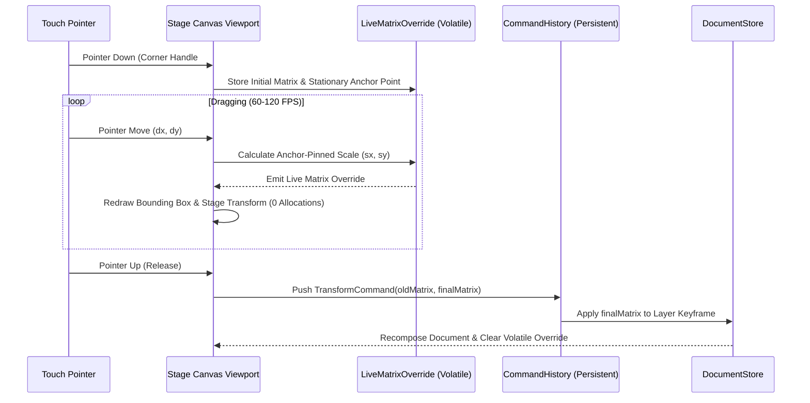
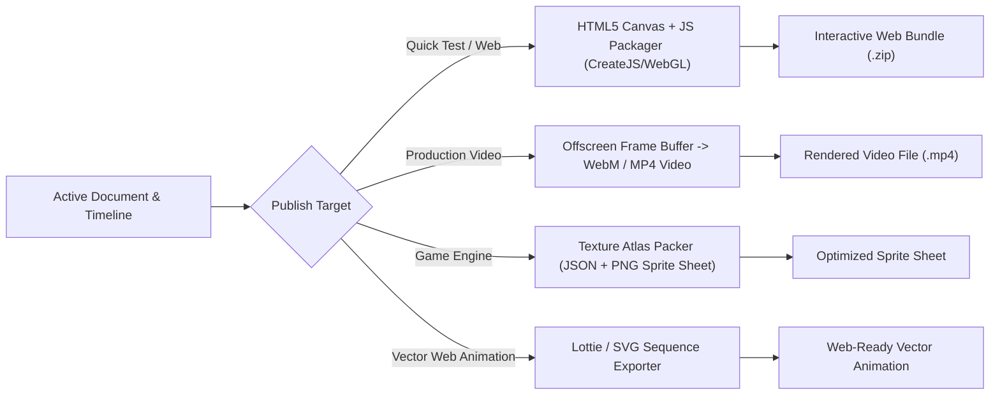

# MASTER ARCHITECTURE & UI/UX SPECIFICATION REPORT
## Full-Featured Web & Mobile-Friendly Adobe Animate CC Clone
**Document Version:** 1.0.0  
**Status:** Architecture Review & Approval Stage  
**Lead Authors:** Principal System Architect & Lead UI/UX Engineer  
**Date:** October 2026  

---

## EXECUTIVE SUMMARY

This specification establishes the architectural, interaction design, state management, and rendering blueprint for a high-fidelity, cross-platform (Web & Mobile) clone of **Adobe Animate CC 2023/2024**. 

The application replicates the industry-standard dark-theme **Basic Workspace** consisting of:
1. **Top Application Menu Bar & Quick Actions**
2. **Left 1-Column Vector & Transform Toolbar**
3. **Hardware-Accelerated Interactive Canvas/Stage**
4. **Docked Multi-Layer Dope Sheet Timeline**
5. **Right Properties Inspector & Library Panel**

### Primary Architectural Challenge
On desktop viewports ($\ge 1024\text{px}$), the traditional multi-dock layout provides immediate access to all inspector panels. However, on mobile viewports ($< 768\text{px}$ and touch devices), rigid desktop panels consume up to **80% of the viewport**, severely cramping the primary creative surface (the Canvas/Stage) into an unworkable thumbnail ($< 20\%$ screen area).

This master report specifies a **mobile-first drawer and overlay architecture** allowing the **Interactive Stage to occupy 75%–85% of mobile screens** while preserving 1:1 desktop parity, instant keyboard/touch tool switching, sub-pixel vector rendering, and zero-allocation 60–120 FPS playback loops.

```
+================================================================================================+
|                                 HIGH-LEVEL PLATFORM TARGET                                     |
+================================================================================================+
| Target Screen Coverage on Mobile Touch:  75% - 85% Active Canvas Area                          |
| Touch Hit Accuracy:                      44px x 44px Minimum Touch Targets                     |
| Free Transform Touch Radius:             32px - 48px Target Hit Rings                          |
| Rendering Performance Target:            60 FPS Constant / 120 FPS High-Refresh ProMotion      |
| Document Fidelity:                       1:1 DOMDocument.xml FLA Parsing & Serialization        |
| Cross-Platform Parity:                   Web (HTML5 Canvas + WebGL) & Mobile (Compose/Native)  |
+================================================================================================+
```

---

## 1. UI/UX ARCHITECTURE & DESIGN SYSTEM AUDIT (DESKTOP VS. MOBILE)

### 1.1 Current UI Audit & Bottleneck Analysis

The current studio layout models Adobe Animate CC's **Basic Workspace**:

```
+------------------------------------------------------------------------------------------------+
|  Top Menu Bar (File, Edit, View, Insert, Modify, Text, Commands, Control, Debug, Window, Help) |
+----+--------------------------------------------------------------------+----------------------+
| T  | Document Tabs: [Character 7 Man.fla x]                             | Properties | Library |
| O  +--------------------------------------------------------------------+----------------------+
| O  | Scene 1 Breadcrumb | [o] Center | [ ] Fullscreen | 20% Zoom | Color  | Tool | Object | Frame|
| L  +--------------------------------------------------------------------+----------------------+
| B  |                                                                    | Doc Settings:        |
| A  |                        INTERACTIVE STAGE                           | W: 3840  H: 2160     |
| R  |                         (CANVAS VIEWPORT)                          | FPS: 30.00           |
|    |                                                                    | Stage: [ #FFFFFF ]   |
| (V)|                                                                    | Match contents       |
| (A)|                                                                    | [ ] Scale Content    |
| (Q)|                                                                    | Publish Settings...  |
| .  +--------------------------------------------------------------------+----------------------+
| .  | Timeline: [>] [<<] [>>] 30.00 FPS  Frame: 300F | O-O Onion Skin    |                      |
| .  | Layer 1: [Eye] [Lock] [Outline]  |===[]===========================|                      |
|    | Layer 2: [Eye] [Lock] [Outline]  |=======[]=======================|                      |
+----+--------------------------------------------------------------------+----------------------+
```

#### Identified Layout Bottlenecks on Screen Sizes $< 1024\text{px}$:
1. **Vertical Space Squashing (Top & Bottom Docks):**
   - Top App Bar ($32\text{dp}$) + Document Tab Bar ($28\text{dp}$) + Scene Navigation Bar ($28\text{dp}$) = $88\text{dp}$.
   - Docked Bottom Timeline = $220\text{dp}$ to $260\text{dp}$.
   - Total non-canvas vertical overhead = $308\text{dp}$ to $348\text{dp}$.
   - On a typical smartphone in landscape ($390\text{dp} \times 844\text{dp}$ or $412\text{dp} \times 915\text{dp}$), this leaves **less than $64\text{dp}$ to $104\text{dp}$ of vertical canvas space** (a slit!).
2. **Horizontal Space Starvation (Left & Right Docks):**
   - Left 1-Column Toolbar = $38\text{dp}$.
   - Right Inspector Dock (Properties & Library) = $280\text{dp}$ fixed width.
   - Total non-canvas horizontal overhead = $318\text{dp}$ ($38\%$ of standard mobile screen width).
3. **Touch Inaccessibility:**
   - Desktop icon buttons ($15\text{dp}$ to $24\text{dp}$) are far too small for fingers, causing mis-taps.
   - Transform handles drawn at $12\text{px}$ raw ($3.4\text{dp}$ on 560 DPI) cannot be accurately gripped without precision stylus input.
   - Desktop menus (11 horizontal items) overflow and wrap unpredictably on small screens.

---

### 1.2 Design Tokens & Theme Specification (Adobe Spectrum Dark)

The UI adheres strictly to **Adobe Spectrum Dark Theme v2** standards.

#### Color System Tokens
| Token Name | Hex Code | Role & Application |
|:---|:---|:---|
| `--spectrum-bg-app` | `#181818` | Outer application window background, pasteboard backdrop |
| `--spectrum-bg-surface` | `#262626` | Panel backgrounds (Left toolbar, Right dock, Bottom timeline) |
| `--spectrum-bg-header` | `#2B2B2B` | Menu bar, tab strips, timeline control header |
| `--spectrum-bg-card` | `#323232` | Nested cards, input field backdrops, selected tool state |
| `--spectrum-border-subtle` | `#383838` | Internal dividers, grid lines, dock borders |
| `--spectrum-border-bold` | `#4B4B4B` | Input borders, timeline major grid lines, tab dividers |
| `--spectrum-accent-blue` | `#1473E6` | Adobe CC primary accent, playhead needle, active toggles |
| `--spectrum-selection-cyan`| `#00C0FF` | Free Transform bounding box, scale handles, marquee selection |
| `--spectrum-selection-blue`| `#00A4FF` | Selection tool outline, subselection vector nodes |
| `--spectrum-text-primary` | `#F5F5F5` | Primary labels, document dimensions, active tab text |
| `--spectrum-text-secondary`| `#909090` | Timecode labels, shortcut keys, disabled state text |
| `--spectrum-classic-tween` | `#7C5DA2` | Classic tween frame span background (Adobe Animate purple) |
| `--spectrum-motion-tween` | `#9B693A` | Motion tween frame span background (amber-brown) |
| `--spectrum-shape-tween` | `#5C8A4D` | Shape tween frame span background (green) |
| `--spectrum-pivot-red` | `#E53935` | Center transformation pivot registration dot |

#### Typography Tokens
- **Font Stack:** `Adobe Clean, system-ui, -apple-system, BlinkMacSystemFont, "Segoe UI", Roboto, sans-serif`
- **Application Menu:** `11px`, Regular, letter-spacing `0.2px`
- **Panel Titles & Headers:** `12px`, Bold, uppercase, letter-spacing `0.5px`
- **Body & Property Labels:** `11px`, Regular
- **Timecode & Numbers:** `11px`, Monospace (`Consolas, Monaco, "Roboto Mono"`)

---

### 1.3 Responsive & Mobile-First UX Strategy

#### Exact Viewport Breakpoints
```
+-------------------------------------------------------------------------------------------------+
| Breakpoint       | Viewport Width     | Layout Mode         | Default Panel Presentation        |
+-------------------------------------------------------------------------------------------------+
| Desktop          | >= 1024px          | Expanded Pro Multi-Dock | All 4 Docks Open & Pinned     |
| Tablet Landscape | 768px - 1023px     | Adaptive Compact    | Left Dock Pinned, Right Slide-Over|
| Mobile Landscape | < 768px (h < 500px)| Canvas-First Touch  | Overlay Drawers (75-85% Stage)    |
| Mobile Portrait  | < 500px (h >= 500px)| Vertical Stacked    | Bottom Drawer Hub (Auto-Rotated)  |
+-------------------------------------------------------------------------------------------------+
```

#### Mobile Viewport Adaptation Architecture (75%–85% Stage Real Estate)
On Mobile (`< 768px`), all secondary controls yield priority to the primary workspace:

1. **Top Menu Bar $\rightarrow$ Single Hamburger Drawer (`≡`) + Quick Action Bar ($36\text{dp}$ total):**
   - The 11 desktop text menus (`File`, `Edit`, etc.) collapse into a slide-in Hamburger Drawer (`≡`).
   - The visible top bar retains only crucial live actions:
     - `≡` (Main Menu Drawer Toggle)
     - Document Name Pill (`Character 7 Man.fla`)
     - `↶` Undo / `↷` Redo
     - Current Zoom Pill (`20% ▾`)
     - `▶ Test` (Instant Playback / Preview)
     - `⚙` Workspace / Settings
     - `>>` Inspector Toggle Button

2. **Right Properties/Library Dock $\rightarrow$ Slide-Over Overlay Drawer:**
   - Hidden by default on mobile.
   - When tapped (`>>` button), it slides smoothly over the right side of the canvas as a semi-transparent floating glass card ($300\text{px}$ wide, $85\%$ screen height, `backdrop-filter: blur(16px)`).
   - Touching outside or tapping `✕` instantly dismisses it, restoring full canvas visibility.

3. **Bottom Timeline $\rightarrow$ 3-State Collapsible Drawer:**
   - **State 1: Minimized Scrubber Bar ($40\text{px}$ height - Default on Mobile):**
     - Shows Play/Pause (`▶`), Timecode (`300 F / 10.0s`), and a full-width high-precision scrubbing slider. Stage occupies **$82\%$** of screen height.
   - **State 2: Half-Open Layer Editor ($180\text{px}$ to $220\text{px}$ height):**
     - Triggered by swiping up on the scrubber bar or tapping the `▲` chevron.
     - Displays layer names, visibility/lock toggles, and frame dope sheet for keyframe manipulation.
   - **State 3: Fully Hidden ($0\text{px}$ height):**
     - Clean presentation mode. Canvas occupies **$92\%$** of screen area.

4. **Left Toolbar $\rightarrow$ Scrollable Touch Bar with Long-Press Flyouts:**
   - Fixed width of $44\text{dp}$ with $44\text{dp} \times 44\text{dp}$ ergonomic touch targets.
   - Tools with sub-variants (e.g., `Rectangle` $\rightarrow$ `Oval`, `Primitive Rectangle`) display a small bottom-right triangle caret; tapping selects the tool, while a **long-press (300ms)** triggers an Adobe CC popover flyout.

---

### 1.4 ASCII Wireframe Comparison: Desktop vs. Mobile

#### A. Desktop Basic Workspace ($\ge 1024\text{px}$)
```
+------------------------------------------------------------------------------------------------------------------+
| An File  Edit  View  Insert  Modify  Text  Commands  Control  Debug  Window  Help     [Share] [▶ Test] [Basic ▾] |
+---+------------------------------------------------------------------------------------+-------------------------+
|   | Character 7 Man.fla [x]                                                            | Properties Color Align  |
| V +------------------------------------------------------------------------------------+ Tool Object Frame [Doc]  |
| A | Scene 1 ▾                              [Center] [Fullscreen]  [ 20% ▾]  [#FFFFFF]  +-------------------------+
| Q |                                                                                    | Document Settings       |
| L |                                                                                    |                         |
|   |                                                                                    | W: [ 3840 ] px          |
| B |                            STAGE / CANVAS VIEWPORT                                 | H: [ 2160 ] px          |
| Y |                                                                                    |                         |
| E |                        +-----------------------------+                             | FPS: [ 30.00 ]          |
| R |                        |                             |                             | Stage: [ #FFFFFF ]      |
| N |                        |       [Character Rig]       |                             |                         |
| P |                        |                             |                             | [ Match Contents ]      |
| T |                        +-----------------------------+                             | [x] Scale Content       |
| K |                                                                                    |                         |
| I |                                                                                    | Publish Settings...     |
|   +------------------------------------------------------------------------------------+ [ More Settings ]       |
| H | Timeline   Output                                                    [^] [≡]       |                         |
| Z +------------------------------------------------------------------------------------+-------------------------+
|   | [Play] [Step] [Loop] [Onion]  30.00 FPS   Frame: [300]   10.0s   [----Zoom----+]   | Library:                |
|   | [Layer+] [Folder] [Del]     [Eye] [Lock] [Outline]   1   5   10  15  20  25  30... | > Seth Character        |
|---| Layer 1: Character_Back_Pose   *     *      []     |===[]=======================| | > Dhoti                 |
|[] | Layer 2: Character_Walking     *     *      []     |=======[]===================| | > Hair Pagri            |
+---+------------------------------------------------------------------------------------+-------------------------+
```

#### B. Mobile Landscape Workspace ($< 768\text{px}$, Stage Real Estate: $82\%$)
```
+------------------------------------------------------------------------------------------------------------------+
| [≡] Character 7 Man  |  [↶] [↷]  |  [ 20% ▾]  |  [▶ Test]                                             [⚙] [>>]  |
+---+--------------------------------------------------------------------------------------------------------------+
| V |                                                                                                              |
| A |                                                                                                              |
| Q |                                       STAGE / CANVAS VIEWPORT                                                |
| B |                                  (OCCUPIES 82% OF TOTAL SCREEN)                                              |
| E |                                                                                                              |
| R |                               +-------------------------------------+                                        |
| P |                               |                                     |                                        |
| T |                               |       [Active Character Pose]       |                                        |
| K |                               |       (Pinch-Zoom / Two-Finger Pan) |                                        |
|   |                               |                                     |                                        |
| H |                               +-------------------------------------+                                        |
| Z |                                                                                                              |
|   |                                                                                                              |
+---+--------------------------------------------------------------------------------------------------------------+
| [▶]  [ 300 F / 10.0s ]  |----O-------------------------------------------------------|  [▲ Expand Timeline]     |
+------------------------------------------------------------------------------------------------------------------+
```

#### C. Mobile Landscape with Slide-Over Properties Overlay Active
```
+------------------------------------------------------------------------------------------------------------------+
| [≡] Character 7 Man  |  [↶] [↷]  |  [ 20% ▾]  |  [▶ Test]                                             [⚙] [<<]  |
+---+----------------------------------------------------------+---------------------------------------------------+
| V |                                                          | PROPERTIES DOCK OVERLAY                       [✕] |
| A |                   STAGE CANVAS                           +---------------------------------------------------+
| Q |               (Partially Dimmed Backdrop)                | [Tool]  [Object]  [Frame]  [Doc]                  |
| B |                                                          +---------------------------------------------------+
| E |                                                          | Document: Character 7 Man                         |
| R |                                                          | Dimensions: [ 3840 ] x [ 2160 ]                   |
| P |                                                          | Frame Rate: [ 30.00 ] FPS                         |
| T |                                                          | Stage Fill: [ #FFFFFF ]                           |
| K |                                                          | [ Match Contents ]   [x] Scale Content            |
+---+----------------------------------------------------------+---------------------------------------------------+
| [▶]  [ 300 F / 10.0s ]  |----O-------------------------------------------------------|  [▲ Expand Timeline]     |
+------------------------------------------------------------------------------------------------------------------+
```

---

### 1.5 Touch & Gesture UX Specification

1. **Multi-Touch Viewport Navigation:**
   - **Two-Finger Pinch:** Scales `viewport.zoom` continuously around the touch centroid point:
     $$\text{centroid} = \left(\frac{p_1.x + p_2.x}{2}, \frac{p_1.y + p_2.y}{2}\right)$$
     $$\text{zoom}_{\text{new}} = \text{zoom}_{\text{prev}} \times \left(\frac{\text{dist}_{\text{now}}}{\text{dist}_{\text{prev}}}\right)$$
   - **Two-Finger Drag:** Translates the canvas offset (`panX`, `panY`) smoothly without deselecting active elements.
2. **Free Transform Handle Touch Targets:**
   - Visual handle size: $22\text{px} \times 22\text{px}$ crisp white square with $2\text{px}$ dark outline.
   - Invisible Touch Target padding: **$44\text{px} \times 44\text{px}$** hit ring around each handle (`touchRadiusSq = 48f * 48f`).
   - Center pivot target: $24\text{px}$ touch radius.
3. **Touch-Draggable Numeric Scrubbers (e.g., $W$, $H$, FPS, Rotation):**
   - Direct tap opens numeric keypad.
   - Horizontal drag on numeric labels (`W:`, `H:`, `FPS:`) scrubs values dynamically at $1\text{px} = 1\text{unit}$ ($10\text{units}$ with two fingers).

---

## 2. COMPLETE SYSTEM & FRONTEND ARCHITECTURE

### 2.1 High-Level Architecture Diagram



---

### 2.2 Component Hierarchy Tree

```
AppWorkspaceRoot (Theme Provider, Window Size Classifier, Global Shortcut Listener)
├── TopApplicationBar
│   ├── HamburgerMenuButton (Mobile Drawer Toggle)
│   ├── DocumentTabBar
│   │   └── DocumentTabItem (File Name, Dirty Indicator, Close Button)
│   ├── SceneBreadcrumbBar (Scene 1 ▾, Drill-down Path)
│   ├── ViewportQuickActions (Center, Fullscreen, ZoomDropdown, StageColorPicker)
│   ├── PlaybackQuickTestButton (▶ Test / Export)
│   └── WorkspaceModeSelector (Basic, Classic, Touch Mobile)
├── WorkspaceMainBody (Adaptive Row / Box Layout)
│   ├── LeftToolboxPalette (Desktop Pinned or Mobile Floating Drawer)
│   │   ├── ToolboxHeader (Collapse <<, Flyout Menu ≡)
│   │   ├── ToolSectionSelection (Selection V, Subselection A, Free Transform Q, Lasso L)
│   │   ├── ToolSectionVectorDraw (Classic Brush B, Paint Brush Y, Eraser E, Rectangle R, Line N)
│   │   ├── ToolSectionVectorEdit (Pen P, Text T, Paint Bucket K, Eyedropper I, Asset Warp W)
│   │   ├── ToolSectionNavigate (Hand H, Zoom Z)
│   │   └── ToolColorSwatches (Active Fill, Active Stroke, Swap, Default B/W)
│   ├── StageCanvasViewport (Weight = 1f, ClipToBounds)
│   │   ├── InfinitePasteboardCanvas (Hardware Rendered Backdrop)
│   │   ├── StageSurfaceBoundary (W x H Stage Frame with 1px border)
│   │   ├── HardwareVectorDisplayListLayer (Precompiled Draw Commands)
│   │   ├── InteractiveSelectionOverlayLayer (Selection Bounding Box & Pivot)
│   │   └── FreeTransformHandleOverlayLayer (8 Anchored Handles & Touch Target Rings)
│   └── RightInspectorDock (Desktop Pinned or Mobile Slide-Over Overlay)
│       ├── InspectorTabStrip (Assets, Properties, Color, Align, Library)
│       ├── PropertiesPanelContainer
│       │   ├── PropertiesSubTabStrip (Tool, Object, Frame, Doc)
│       │   ├── ToolPropertiesView (Stroke Weight, Cap, Join, Smoothing, Brush Size)
│       │   ├── ObjectPropertiesView (Instance Name, Symbol Type, X, Y, W, H, Rotation, Alpha)
│       │   ├── FramePropertiesView (Frame Label, Tween Mode: Classic/Motion/Shape, Ease Preset)
│       │   └── DocPropertiesView (Canvas Dimensions W x H, FPS, Stage Color, Publish Profile)
│       └── LibraryPanelContainer (Symbol Tree, Bitmap List, Audio, Add Symbol +, Trash)
└── BottomTimelineDock (Desktop Docked or Mobile 3-State Drawer)
    ├── TimelineTabStrip (Timeline, Output, Height Resize Handle ▲/▼)
    ├── TimelineTransportHeader
    │   ├── TransportControls (Step Backward, Play/Pause, Step Forward, Loop, Onion Skin)
    │   ├── TimecodeIndicators (30.00 FPS, Current Frame 300 F, Seconds Marker)
    │   └── TimelineZoomSlider (Frame Width Scaling)
    └── TimelineDopeSheetContainer (Synchronized Dual Scroll)
        ├── LayerHeadersColumn (Layer Name, Add Layer +, Folder, Eye, Lock, Outline)
        └── FrameGridColumn (Time Ruler Header, Keyframe Cells, Tween Spans, Blue Playhead)
```

---

## 3. STATE MANAGEMENT & DATA FLOW ARCHITECTURE

### 3.1 Global & Local State Schema (TypeScript Definitions)

```typescript
// ============================================================================
// 1. DOCUMENT DATA SCHEMA
// ============================================================================

export interface AnimateDocument {
  id: string;
  name: string;
  width: number;             // e.g. 3840
  height: number;            // e.g. 2160
  frameRate: number;         // e.g. 30.0
  backgroundColorHex: string;// e.g. "#FFFFFF"
  scaleContent: boolean;     // Rescales keyframe elements on document resize
  mainTimeline: AnimateTimeline;
  library: Record<string, AnimateSymbolItem>;
}

export interface AnimateTimeline {
  name: string;              // "Scene 1" or Symbol Name
  layers: AnimateLayer[];
  frameCount: number;        // Total duration in frames
}

export interface AnimateLayer {
  id: string;
  name: string;              // e.g. "Character_Back_Pose"
  layerType: 'NORMAL' | 'GUIDE' | 'MASK' | 'MASKED' | 'FOLDER';
  colorHex: string;          // Layer outline color (e.g. "#4B8EC4")
  isVisible: boolean;
  isLocked: boolean;
  isOutline: boolean;
  parentLayerIndex?: number; // Bone rigging parent or mask parent
  frames: AnimateFrame[];
}

export interface AnimateFrame {
  index: number;             // 0-based frame index
  duration: number;          // Number of frames this keyframe extends
  elements: AnimateElement[];
  tweenType?: 'NONE' | 'CLASSIC' | 'MOTION' | 'SHAPE';
  motionTweenRotate?: 'AUTO' | 'CW' | 'CCW';
  motionTweenRotateTimes?: number;
  label?: string;
}

export type AnimateElement = 
  | AnimateSymbolInstance 
  | AnimateShape 
  | AnimateBitmapInstance 
  | AnimateGroup;

export interface AnimateSymbolInstance {
  type: 'SYMBOL_INSTANCE';
  libraryItemName: string;
  matrix: AnimateMatrix2D;
  transformationPoint: { x: number; y: number };
  colorTransform?: AnimateColorTransform;
  loopType?: 'LOOP' | 'PLAY_ONCE' | 'SINGLE_FRAME';
  firstFrame?: number;
}

export interface AnimateMatrix2D {
  a: number;   // Scale X * cos(skewY)
  b: number;   // Scale X * sin(skewY)
  c: number;   // -Scale Y * sin(skewX)
  d: number;   // Scale Y * cos(skewX)
  tx: number;  // Translation X
  ty: number;  // Translation Y
}

// ============================================================================
// 2. WORKSPACE UI STATE SCHEMA
// ============================================================================

export type StudioTool = 
  | 'SELECTION' | 'SUBSELECTION' | 'FREE_TRANSFORM' | 'LASSO'
  | 'CLASSIC_BRUSH' | 'PAINT_BRUSH' | 'ERASER' | 'RECTANGLE' | 'LINE'
  | 'PEN' | 'TEXT' | 'PAINT_BUCKET' | 'EYEDROPPER' | 'ASSET_WARP'
  | 'HAND' | 'ZOOM';

export interface WorkspaceUIState {
  preset: 'Basic' | 'Classic' | 'Touch';
  viewportWidth: number;
  viewportHeight: number;
  isMobile: boolean;                 // Calculated: width < 768px
  isTablet: boolean;                 // Calculated: 768px <= width < 1024px
  
  // Drawer States
  isMainMenuOpen: boolean;           // Mobile top drawer (≡)
  isRightDrawerOpen: boolean;        // Mobile slide-over properties inspector
  timelineDrawerState: 'MINIMIZED' | 'HALF_OPEN' | 'HIDDEN';
  
  // Active Selections
  activeTool: StudioTool;
  activeRightTab: 'ASSETS' | 'PROPERTIES' | 'COLOR' | 'ALIGN' | 'LIBRARY';
  activePropertiesSubTab: 'TOOL' | 'OBJECT' | 'FRAME' | 'DOC';
  
  // Swatches
  activeFillColor: string;
  activeStrokeColor: string;
  strokeWidth: number;
}

// ============================================================================
// 3. TIMELINE & PLAYBACK STATE SCHEMA
// ============================================================================

export interface TimelineState {
  currentFrame: number;              // 0-based active playhead position
  selectedLayerIndex: number;
  isPlaying: boolean;
  loopEnabled: boolean;
  loopRange: [number, number];       // Start and End frame indices
  onionSkinEnabled: boolean;
  onionSkinRange: [number, number];  // Relative backwards and forwards frames
  frameZoomLevel: number;            // 1.0 = standard, 2.0 = stretched cells
}

// ============================================================================
// 4. STAGE VIEWPORT & SELECTION STATE SCHEMA
// ============================================================================

export interface StageViewportState {
  zoom: number;                      // Current scale multiplier (e.g. 0.20 = 20%)
  panX: number;                      // Canvas X offset in pixels
  panY: number;                      // Canvas Y offset in pixels
  stageWidth: number;                // Document width (3840)
  stageHeight: number;               // Document height (2160)
  clipToStage: boolean;
}

export interface SelectedElementBounds {
  layerIndex: number;
  elementIndex: number;
  bounds: { left: number; top: number; right: number; bottom: number };
  orientedCorners: [
    { x: number; y: number }, // Top-Left
    { x: number; y: number }, // Top-Right
    { x: number; y: number }, // Bottom-Right
    { x: number; y: number }  // Bottom-Left
  ];
  pivot: { x: number; y: number };
  initialMatrix: AnimateMatrix2D;
}
```

---

### 3.2 Event Bus & Command History (Undo/Redo Pattern)

To ensure responsive real-time dragging without polluting the undo stack with thousands of intermediate points, actions use a **Commit-on-Release Command Pattern**:



---

## 4. CANVAS RENDERING & ANIMATION ENGINE ARCHITECTURE

### 4.1 High-Resolution Canvas Scaling & Coordinate Transformation Math

The document authoring resolution is typically high (e.g., $3840 \times 2160$ UHD or $1920 \times 1080$ FHD), rendered inside a responsive mobile/web viewport container (e.g., $844 \times 390\text{px}$).

#### The Transformation Pipeline:
$$\begin{bmatrix} x_{\text{screen}} \\ y_{\text{screen}} \\ 1 \end{bmatrix} = \begin{bmatrix} \text{zoom} & 0 & \text{panX} \\ 0 & \text{zoom} & \text{panY} \\ 0 & 0 & 1 \end{bmatrix} \begin{bmatrix} x_{\text{stage}} \\ y_{\text{stage}} \\ 1 \end{bmatrix}$$

#### 1. Screen to Stage Inverse Transformation:
$$\text{stageX} = \frac{\text{clientX} - \text{containerLeft} - \text{panX}}{\text{zoom}}$$
$$\text{stageY} = \frac{\text{clientY} - \text{containerTop} - \text{panY}}{\text{zoom}}$$

#### 2. Stage to Screen Forward Transformation:
$$\text{screenX} = \text{stageX} \times \text{zoom} + \text{panX} + \text{containerLeft}$$
$$\text{screenY} = \text{stageY} \times \text{zoom} + \text{panY} + \text{containerTop}$$

#### 3. Anchor-Pinned Free Transform Math (Adobe CC Parity):
When dragging any handle, the **opposite corner or edge remains strictly pinned**, eliminating position jumps:

| Handle Index | Handle Name | Stationary Anchor Point | Scaling Math Formula |
|:---|:---|:---|:---|
| **0** | Top-Left Corner | Corner 2 (Bottom-Right) | $s_x = \frac{w_0 - dx}{w_0}, \quad s_y = \frac{h_0 - dy}{h_0}$ |
| **1** | Top-Right Corner| Corner 3 (Bottom-Left)  | $s_x = \frac{w_0 + dx}{w_0}, \quad s_y = \frac{h_0 - dy}{h_0}$ |
| **2** | Bottom-Right Corner | Corner 0 (Top-Left) | $s_x = \frac{w_0 + dx}{w_0}, \quad s_y = \frac{h_0 + dy}{h_0}$ |
| **3** | Bottom-Left Corner  | Corner 1 (Top-Right)| $s_x = \frac{w_0 - dx}{w_0}, \quad s_y = \frac{h_0 + dy}{h_0}$ |
| **4** | Top Edge Midpoint   | Bottom Edge ($C_2.y$)| $s_x = 1.0, \quad s_y = \frac{h_0 - dy}{h_0}$ |
| **5** | Right Edge Midpoint | Left Edge ($C_0.x$)  | $s_x = \frac{w_0 + dx}{w_0}, \quad s_y = 1.0$ |
| **6** | Bottom Edge Midpoint| Top Edge ($C_0.y$)   | $s_x = 1.0, \quad s_y = \frac{h_0 + dy}{h_0}$ |
| **7** | Left Edge Midpoint  | Right Edge ($C_1.x$) | $s_x = \frac{w_0 - dx}{w_0}, \quad s_y = 1.0$ |

The affine scale matrix around anchor $(A_x, A_y)$ is given by:
$$M_{\text{scale}} = T(A_x, A_y) \cdot S(s_x, s_y) \cdot T(-A_x, -A_y)$$
$$M_{\text{final}} = M_{\text{scale}} \cdot M_{\text{initial}}$$

---

### 4.2 High-Performance 60 FPS / 120 FPS Playback Loop

To prevent garbage collection stutters during timeline playback:
1. **Command List Pre-Compilation:** Shapes, closed vector fills, and strokes are compiled into a flat array of `AnimateDrawCommand` objects per keyframe and cached in an LRU memory cache.
2. **Timing Loop:** Uses `requestAnimationFrame` with high-resolution delta timing:
   ```javascript
   let lastTime = performance.now();
   const frameDurationMs = 1000 / fps; // 33.33ms for 30 FPS
   let accumulator = 0;

   function playbackLoop(currentTime) {
     if (!isPlaying) return;
     const delta = currentTime - lastTime;
     lastTime = currentTime;
     accumulator += delta;

     while (accumulator >= frameDurationMs) {
       currentFrame = (currentFrame + 1) % totalFrames;
       accumulator -= frameDurationMs;
     }
     renderStage(currentFrame);
     requestAnimationFrame(playbackLoop);
   }
   ```
3. **Zero Allocations During Paint:** Matrix transforms, colors, and path allocations are reused from static pools.

---

## 5. FILE SYSTEM, ASSET MANAGEMENT & EXPORT PIPELINE

### 5.1 Project Package & File Format Architecture

```
+------------------------------------------------------------------------------------------------+
| PROJECT PACKAGE SCHEMA (.fla or .toonix bundle)                                                |
+------------------------------------------------------------------------------------------------+
| ├── DOMDocument.xml       -> Master document metadata, Scene 1 timeline, layers, frame spans   |
| ├── LIBRARY/              -> Symbol definitions (Graphics, MovieClips, Nested Timelines)       |
| │   ├── Character_Rig.xml                                                                      |
| │   └── Seth_Head.xml                                                                          |
| ├── bin/                  -> Serialized binary geometry & vector stroke cache                  |
| └── LIBRARY_ASSETS/       -> Embedded PNG/JPEG raster textures, SVG icons, audio assets        |
+------------------------------------------------------------------------------------------------+
```

### 5.2 Publish Settings & Export Pipeline (`▶ Test`)

The clone supports 4 industry-standard export pipelines:



1. **`▶ Test` (Instant Interactive Preview):**
   - Spawns an isolated high-performance canvas overlay playing the compiled timeline at 30 FPS with full interactivity, looping, and sound sync.
2. **HTML5 Canvas / CreateJS:**
   - Emits a standalone `index.html` with vector draw commands translated directly to HTML5 2D Canvas context operations (`ctx.beginPath()`, `ctx.bezierCurveTo()`, `ctx.fill()`).
3. **High-Resolution Video Export:**
   - Evaluates frames $0 \dots N$ offscreen at $3840 \times 2160$, piping RGBA pixel buffers into a WebCodecs / MediaRecorder encoder to produce crisp MP4/H.264 or WebM video.

---

## 6. PHASED IMPLEMENTATION & REFACTORING ROADMAP

```
+==================================================================================================+
|                                    IMPLEMENTATION ROADMAP                                        |
+==================================================================================================+
| Phase 1: Responsive Workspace Shell & Mobile Drawer Architecture (UI/UX Overhaul)                |
| Phase 2: Touch Gesture Engine, Viewport Zoom/Pan Math & Enlarged Transform Controls              |
| Phase 3: Timeline Scrubbing, Layer Management & Property Inspector Two-Way Binding               |
| Phase 4: Performance Optimization (60fps Canvas Rendering, Cache Virtualization) & Export       |
+==================================================================================================+
```

### Phase 1: Responsive Workspace Shell & Mobile Drawer Architecture
- [ ] Implement `WindowSizeClassifier` detecting `Desktop (>= 1024px)`, `Tablet (768-1023px)`, and `Mobile (< 768px)`.
- [ ] Build the mobile **Hamburger Drawer (`≡`)** housing the 11 desktop menus (`File`, `Edit`, `View`, `Insert`, `Modify`, `Text`, `Commands`, `Control`, `Debug`, `Window`, `Help`).
- [ ] Build the **Quick Actions Bar** for mobile containing Undo, Redo, Zoom %, ▶ Test, and Inspector toggle.
- [ ] Convert the Right Properties/Library Dock into a **Slide-Over Overlay Drawer** (`300px` width, semi-transparent frosted glass, backdrop blur).
- [ ] Convert the Bottom Timeline into a **3-State Collapsible Drawer** (Minimized $40\text{px}$ Scrubber Bar, Half-Open Layer Editor, Hidden).
- [ ] Configure the Left Toolbar with $44\text{dp} \times 44\text{dp}$ touch targets and long-press tool popovers.

### Phase 2: Touch Gesture Engine, Viewport Math & Enlarged Controls
- [ ] Implement multi-touch pinch-to-zoom and two-finger canvas pan centered on gesture centroids.
- [ ] Enlarge Free Transform bounding box outlines ($3.2\text{px}$ cyan stroke `#00C0FF`) and 8 corner/edge handles ($22\text{px} \times 22\text{px}$ with $48\text{px}$ touch hit padding).
- [ ] Implement mathematically verified **Anchor-Pinned Scaling** (opposite handle anchored during scale to eliminate position drift).
- [ ] Connect single-touch instant selection on pointer down, enabling immediate drag-to-move without requiring pre-selection.
- [ ] Build touch-draggable numeric scrubbers for `W`, `H`, and `FPS` in the Document Settings inspector.

### Phase 3: Timeline Scrubbing, Layer Management & Inspector Two-Way Binding
- [ ] Wire the Minimized Scrubber Bar for 60 FPS playhead scrubbing with real-time frame updating.
- [ ] Implement keyframe dope sheet virtualization (rendering only visible layers and frame columns).
- [ ] Add touch-friendly layer row actions (single tap eye to toggle visibility, lock icon to lock, outline mode).
- [ ] Connect two-way data binding between the Document Settings inspector (`W`, `H`, `FPS`, Stage Color) and the live Document model.
- [ ] Connect Object Inspector to live symbol properties (X, Y, W, H, Rotation, Alpha Multiplier).

### Phase 4: Performance Optimization & Export Pipeline
- [ ] Precompile and cache closed vector paths and fill commands per keyframe to eliminate garbage collection during playback.
- [ ] Validate 60 FPS constant playback on mid-tier mobile hardware and 120 FPS on high-refresh displays.
- [ ] Implement the `▶ Test` modal preview running the animation loop in an isolated sandbox.
- [ ] Build HTML5 Canvas and video export modules.

---

## 7. ARCHITECTURAL SIGN-OFF & APPROVAL GATE

This specification provides the master architectural blueprint for building and refining our full-featured web and mobile Adobe Animate CC clone.

**Next Action:** Awaiting user architectural review and formal approval before starting Phase 1 source code implementation.
